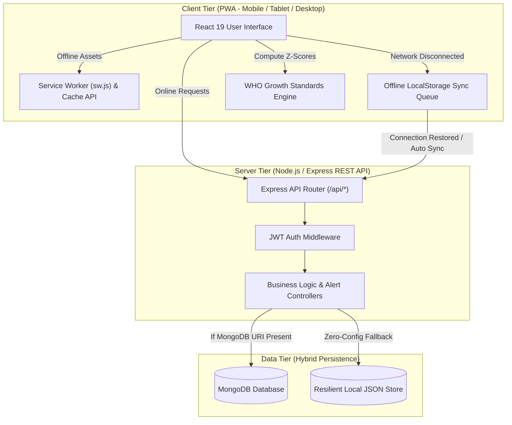
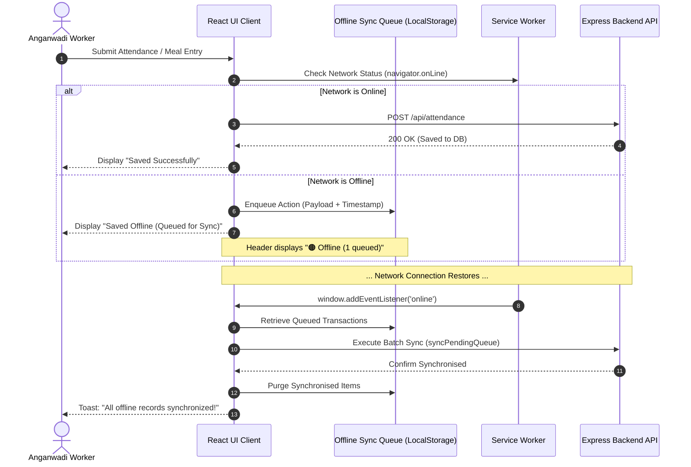
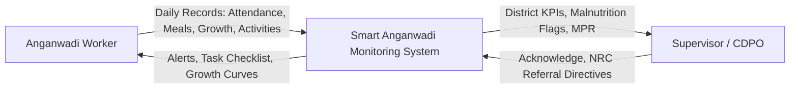
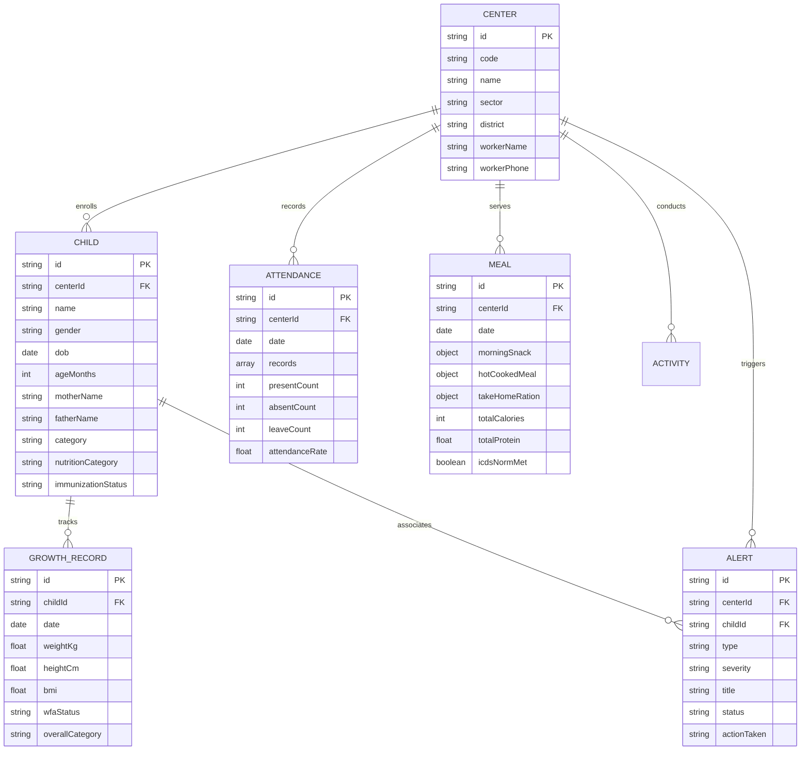

# PROJECT REPORT ON
## SMART ANGANWADI MONITORING SYSTEM
### *A Digital Child Development, Nutrition & Centre Monitoring Progressive Web App (PWA)*

---

**Project Title:** Smart Anganwadi Monitoring System  
**Domain:** Web Development / Public Health Informatics / Social Impact Computing  
**Technology Stack:** React.js, JavaScript (ES6+), PWA (Service Workers & Cache API), Node.js, Express.js, WHO Growth Standards Engine  
**Target Beneficiaries:** Anganwadi Workers (AWW), Helpers, Supervisors (Mukhya Sevikas), and Child Development Project Officers (CDPO)  
**Academic Year:** 2026–2027  

---

## TABLE OF CONTENTS
1. [Abstract](#1-abstract)
2. [Introduction & Background](#2-introduction--background)
   - 2.1 Context: ICDS and POSHAN Abhiyaan
   - 2.2 Problem Statement
   - 2.3 Objectives of the Project
   - 2.4 Scope and Boundaries
3. [Literature Survey & Existing System Analysis](#3-literature-survey--existing-system-analysis)
   - 3.1 Review of Current Manual Register System
   - 3.2 Limitations of Existing Government Portals
   - 3.3 Proposed System Advantages
   - 3.4 Comparison Table: Existing vs. Proposed System
4. [System Requirements & Feasibility Analysis](#4-system-requirements--feasibility-analysis)
   - 4.1 Software Requirements
   - 4.2 Hardware Requirements
   - 4.3 Technical & Operational Feasibility
5. [System Architecture & Design](#5-system-architecture--design)
   - 5.1 High-Level Architecture Diagram
   - 5.2 Progressive Web App (PWA) & Offline-First Sync Architecture
   - 5.3 Data Flow Diagrams (DFD Level 0, Level 1)
   - 5.4 Database & Entity Schema Design
6. [Core Modules & Implementation Details](#6-core-modules--implementation-details)
   - 6.1 User Authentication & Role-Based Access Control
   - 6.2 Child Enrolment & Digital Health Card
   - 6.3 1-Tap Attendance Management & Dropout Risk Detection
   - 6.4 Supplementary Nutrition Programme (SNP) & Calorie-Protein Meter
   - 6.5 WHO Child Growth Monitoring & Interactive Growth Curves
   - 6.6 Early Childhood Care & Education (ECCE) Activity Logging
   - 6.7 Supervisor / CDPO Multi-Centre Analytics Hub
   - 6.8 Automated Monthly Progress Report (MPR) Generation
7. [Mathematical Models & WHO Standard Algorithms](#7-mathematical-models--who-standard-algorithms)
   - 7.1 WHO Z-Score & Standard Deviation Formulations
   - 7.2 Underweight, Stunting, and Wasting Classifications
   - 7.3 ICDS Nutritional Standards Verification
8. [Testing & Quality Assurance](#8-testing--quality-assurance)
   - 8.1 Testing Methodology
   - 8.2 Comprehensive Test Cases & Results
   - 8.3 PWA Offline Simulation Testing
9. [Societal Impact & Future Scope](#9-societal-impact--future-scope)
   - 9.1 Societal Benefits
   - 9.2 Future Enhancements
10. [References & Bibliography](#10-references--bibliography)

---

## 1. ABSTRACT

Anganwadi centres established under India's flagship **Integrated Child Development Services (ICDS)** scheme serve as the primary grassroots infrastructure delivering health, supplementary nutrition, immunization, and preschool early childhood education to over 80 million children below six years of age. Despite this monumental scale, frontline Anganwadi workers continue to record operational data manually across 11 or more physical registers. This traditional methodology produces severe administrative friction, high data discrepancy rates, delayed detection of Severe Acute Malnutrition (SAM), and unnoticed preschool dropouts. Furthermore, existing digital tools frequently fail in rural settings due to unstable cellular internet connectivity.

This project introduces the **Smart Anganwadi Monitoring System**, a mobile-first **Progressive Web App (PWA)** developed using **React.js, JavaScript, and Node.js/Express**. Built on an **offline-first architecture** with Service Workers, local IndexedDB/LocalStorage queues, and automatic background synchronisation, the platform enables Anganwadi workers in remote villages to record daily attendance, supplementary nutrition distribution, child anthropometric measurements, and preschool learning activities without requiring continuous internet access. 

The system incorporates a **WHO Child Growth Standards Engine** that dynamically computes Weight-for-Age, Height-for-Age (stunting), and Body Mass Index (BMI), rendering interactive WHO growth curves and generating automated medical referral alerts for children falling below the -3SD threshold into Severe Acute Malnutrition (SAM). For administrative oversight, a **Supervisor / CDPO Dashboard** aggregates real-time multi-centre performance metrics, identifies centres with missed meal distributions, tracks consecutive absenteeism, and compiles standardized **Monthly Progress Reports (MPR)** exportable to CSV and print formats. The project establishes an accessible, transparent, and resilient digital framework that directly advances public health monitoring and early childhood development governance.

---

## 2. INTRODUCTION & BACKGROUND

### 2.1 Context: ICDS and POSHAN Abhiyaan
Launched in 1975, the Integrated Child Development Services (ICDS) scheme represents one of the world's largest early childhood care programs. Under the overarching umbrella of the **POSHAN Abhiyaan (National Nutrition Mission)**, ICDS provides six core services:
1. Supplementary Nutrition (Morning snacks, Hot Cooked Meals, Take-Home Rations)
2. Growth Monitoring and Promotion
3. Non-formal Pre-School Education
4. Immunization Tracking
5. Health Check-ups
6. Referral Services to Primary Health Centres (PHC) and Nutrition Rehabilitation Centres (NRC)

Frontline delivery is managed by an **Anganwadi Worker (AWW)** and an **Anganwadi Helper (AWH)** at community Anganwadi Centres (AWC).

### 2.2 Problem Statement
1. **Excessive Physical Paperwork**: An Anganwadi worker spends 25% to 35% of her daily working hours manually maintaining multiple heavy physical registers (Family Survey Register, Attendance Register, Supplementary Food Register, Stock/Inventory Register, Child Growth Register, Referral Register).
2. **Latent Malnutrition Detection**: Malnutrition in infants is non-linear. Manual plotting of weight-for-age on paper cards is error-prone, meaning children suffering from Moderate Acute Malnutrition (MAM) or Severe Acute Malnutrition (SAM) are often identified only after visible physical deterioration occurs.
3. **Chronic Absenteeism Leading to Dropouts**: In paper registers, consecutive absences over 3 to 5 days remain unnoticed until monthly compilation, missing critical windows for family counseling and retention.
4. **Rural Connectivity Bottleneck**: Many rural and tribal pockets suffer from intermittent 2G/4G coverage. Cloud-only applications crash or refuse to save form inputs when a network connection drops.
5. **Supervisor Blindspots**: Supervisors (Mukhya Sevikas) overseeing 20 to 25 centres receive physical monthly reports with a 2- to 4-week lag, preventing immediate supervisory intervention when a centre fails to serve meals or maintain hygiene.

### 2.3 Objectives of the Project
- **Digitize Core Frontline Operations**: Provide mobile-first interfaces with 1-tap controls for child attendance, meal distribution, growth assessment, and preschool learning logs.
- **Guarantee 100% Offline Availability**: Implement Progressive Web App (PWA) service workers and client-side transaction queues so workers can operate completely offline without loss of data.
- **Automate WHO Standard Child Growth Classification**: Instantly evaluate height and weight against WHO standard growth tables to categorize children into Normal (Green), MAM (Yellow), and SAM (Red).
- **Proactive Notification & Alert Dispatch**: Automatically generate high-priority escalation tickets for SAM cases (recommending NRC medical admission) and 3-day consecutive absence flags.
- **Empower Supervisory Oversight**: Deliver an aggregated CDPO portal comparing multi-centre compliance, meal distribution fulfillment, and automated Monthly Progress Report (MPR) generation.

### 2.4 Scope and Boundaries
The application is designed for smartphone, tablet, and desktop environments. It covers children aged 6 months to 6 years, categorized into Toddlers (6 months to 3 years) and Preschoolers (3 to 6 years), along with pregnant women and lactating mothers receiving Take-Home Rations (THR).

---

## 3. LITERATURE SURVEY & EXISTING SYSTEM ANALYSIS

### 3.1 Review of Current Manual Register System
Under the traditional regime, every centre maintains 11 standardized physical registers mandated by state women and child welfare departments:
- **Register 1**: Family Details & Survey Register
- **Register 2**: Supplementary Nutrition Stock Register
- **Register 3**: Daily Supplementary Nutrition & Attendance Register
- **Register 4**: Immunization & Health Checkup Register
- **Register 5**: Growth Monitoring Register
- **Register 6**: Referral Register
- **Register 7**: Pre-School Education Activity Diary

Physical records are vulnerable to pest damage, rain, moisture, ink fading, and accidental loss. Furthermore, cross-referencing between registers (e.g., verifying whether an absent child received Take-Home Ration) is practically impossible at scale.

### 3.2 Limitations of Existing Government Portals
While initiatives like the *Poshan Tracker App* exist, field evaluations indicate significant operational gaps:
- Heavy server dependency causing frequent loading timeouts during peak morning hours.
- Inadequate visual feedback regarding the child's growth trajectory over time.
- Complex nested forms unsuitable for workers with basic digital literacy.
- Lack of offline-first queuing mechanisms; failed network submissions are discarded without notifying the worker.

### 3.3 Proposed System Advantages
The Smart Anganwadi Monitoring System resolves these constraints through:
1. **Lightweight PWA Footprint**: Under 1 MB initial asset bundle, installable directly from the browser onto Android and iOS home screens.
2. **Deterministic Offline Sync**: Writes are immediately acknowledged locally, with sync status badges (*"🟢 Online"* vs. *"🟠 Offline: N queued"*) and an on-demand *"⚡ Sync Now"* trigger.
3. **Interactive Visual Growth Analytics**: Uses high-performance vector graphics (SVG) to display child growth trajectories mapped directly against WHO median and standard deviation bands (-3SD, -2SD, Median, +2SD).
4. **Bilingual Accessibility**: English and Hindi toggle with large touch targets (minimum 48px height) adhering to WCAG 2.1 AA accessibility guidelines.

### 3.4 Comparison Table: Existing vs. Proposed System

| Dimension | Manual Paper Registers | Traditional Web Portals | Smart Anganwadi PWA (Proposed) |
| :--- | :--- | :--- | :--- |
| **Data Entry Speed** | Slow (15–20 mins per activity) | Moderate (Form submission lag) | Fast (1-tap toggle, batch "Mark All Present") |
| **Offline Resilience** | Works offline (paper only) | Fails without active internet | **100% Offline-First (Local Sync Queue)** |
| **Growth Assessment** | Manual calculation, error-prone | Static table display | **Automated WHO curves & instant SAM/MAM alerts** |
| **Nutrition Tracking** | Hard to calculate calories/protein | Basic headcount | **Live Calorie & Protein Meter vs. ICDS target** |
| **Absenteeism Alerts** | Spotted only at month-end | None | **Automated 3-day consecutive dropout alert** |
| **Reporting (MPR)** | 7–10 days manual compilation | Manual download | **1-Click MPR generator & CSV export** |
| **Device Portability** | Bulky physical books | Desktop/laptop oriented | **Mobile, tablet & desktop responsive PWA** |

---

## 4. SYSTEM REQUIREMENTS & FEASIBILITY ANALYSIS

### 4.1 Software Requirements
- **Frontend Framework**: React 19 (JavaScript ES6+)
- **Build Tool**: Vite 8.0
- **Routing**: React Router DOM v7
- **Icons**: Lucide React
- **PWA Specifications**: Web App Manifest JSON (`manifest.json`), Service Worker API (`sw.js`), Cache Storage API
- **Backend Runtime**: Node.js (v18.0.0 or higher)
- **API Framework**: Express.js 5.x
- **Data Persistence**: MongoDB (Mongoose ODM) with resilient Zero-Config JSON/In-Memory fallback layer
- **Styling**: Custom Green-and-White CSS3 Design System with CSS Custom Properties, Flexbox, and CSS Grid

### 4.2 Hardware Requirements
- **Frontline Worker Devices**: Any basic smartphone or tablet running Android 8.0+ or iOS 13+ with modern browser (Chrome, Edge, Safari, Firefox).
- **RAM**: Minimum 1 GB RAM (Optimal: 2 GB RAM).
- **Storage**: Minimum 20 MB free space for PWA caching and local IndexedDB/LocalStorage storage.
- **Server Environment**: Any single-core VPS or cloud instance with 512 MB RAM running Node.js.

### 4.3 Technical & Operational Feasibility
- **Technical Feasibility**: The architecture utilizes standardized Web APIs (Service Worker, Cache API, LocalStorage). No proprietary hardware or specialized runtime dependencies are required.
- **Operational Feasibility**: The user interface relies on high-contrast iconography, bilingual terminology (*Poshan*, *Balvatika*, *Kuposhan*), and batch operations (e.g., "Mark All Present"), minimizing cognitive load for workers with low technical fluency.
- **Economic Feasibility**: Zero software licensing costs. Can be hosted on open-source cloud infrastructure, drastically reducing paper and printing expenditures for state departments.

---

## 5. SYSTEM ARCHITECTURE & DESIGN

### 5.1 High-Level Architecture Diagram



### 5.2 Progressive Web App (PWA) & Offline-First Sync Architecture

The offline synchronization engine operates on an optimistic UI model:



### 5.3 Data Flow Diagrams

#### Level 0 DFD (Context Diagram)



#### Level 1 DFD (Decomposed System View)

```mermaid
graph TD
    AWW["Anganwadi Worker"] -->|1. Mark Attendance| P1["Attendance Processor"]
    AWW -->|2. Record Food & THR| P2["Meal & Nutrition Calculator"]
    AWW -->|3. Record Wt/Ht| P3["WHO Growth Classifier"]
    AWW -->|4. Log Sessions| P4["Pre-School Activity Log"]

    P1 --> D1[("Attendance Records")]
    P2 --> D2[("Meal Distribution Log")]
    P3 --> D3[("Child Growth Records")]
    P4 --> D4[("Activity History")]

    P1 -->|Consecutive Absences >= 3| AlertGen["Alert Engine"]
    P3 -->|Weight < -3SD (SAM)| AlertGen

    AlertGen --> D5[("Active Alerts Log")]
    D1 & D2 & D3 & D5 --> P5["Supervisor Aggregator"]
    P5 --> Supervisor["Supervisor / CDPO Dashboard"]
    P5 --> P6["MPR Report Generator"] --> Report[("Monthly Progress Report PDF/CSV")]
```

### 5.4 Database & Entity Schema Design

The system schema includes 7 primary collections/entities:



---

## 6. CORE MODULES & IMPLEMENTATION DETAILS

### 6.1 User Authentication & Role-Based Access Control
The application supports dual operational personas:
1. **Anganwadi Worker (AWW)**: Bound to a designated centre (e.g., *AW-102 Rampur West*). Access is scoped to the centre's children, daily attendance marking, meal distribution forms, child growth cards, and activity logs.
2. **Supervisor / CDPO**: Sector/district-wide access across all centres (*AW-101* through *AW-104*). Includes comparative bar analytics, malnutrition resolution controls, and official MPR generation.
- **Frictionless Demo Switcher**: Includes 1-click authentication shortcuts for instant evaluation without typing credentials.

### 6.2 Child Enrolment & Digital Health Card
- Records child demographic parameters: Full Name, Date of Birth (calculating precise age in months), Gender, Blood Group, Mother/Father name, Aadhaar/ID, Category (6m–3y vs. 3y–6y), and immunization milestone status.
- Each child is assigned a **Digital Health Profile Card** displaying their active WHO status, attendance rate, and historical weight progression.

### 6.3 1-Tap Attendance Management & Dropout Risk Detection
- Fast, accessible attendance roster with color-coded buttons: **Present (Green)**, **Absent (Red)**, and **Leave (Amber)**.
- **Batch Action ("Mark All Present")**: Pre-fills the roster in 1 click, allowing the worker to only toggle the few absent children.
- **Automated Dropout Risk Detection**: If a child is marked absent across three consecutive working days, the system flags a **"Consecutive Absence Alert"** and prompts the worker to schedule a family home visit.

### 6.4 Supplementary Nutrition Programme (SNP) & Calorie-Protein Meter
- **Morning Snack**: Tracks serving of boiled eggs, roasted chana, seasonal fruits, or fortified milk.
- **Hot Cooked Meal (HCM)**: Tracks daily preparation of vegetable khichdi, dal-rice, or dalia.
- **Take-Home Ration (THR)**: Tracks distribution of fortified dry ration packets to toddlers and lactating mothers.
- **Live Calorie & Protein Meter**: Computes aggregate nutritional output in real time against ICDS guidelines:
  $$\text{Calories delivered} \ge 500\text{ kcal},\quad \text{Protein delivered} \ge 12\text{ g}$$
- **Quality & Safety Sign-off**: Requires explicit verification that meals were tasted for temperature and hygiene by the worker and helper prior to distribution.

### 6.5 WHO Child Growth Monitoring & Interactive Growth Curves
- Enables monthly anthropometric entry: Weight (kg) to one decimal place, Height (cm) to 0.5 cm.
- Computes BMI, Weight-for-Age (WFA), and Height-for-Age (HFA) stunting status.
- **Custom Interactive SVG WHO Growth Curve**: Plots child weight trajectory over time directly against standard percentile zones:
  - Green Zone: $\ge -2\text{SD}$ (Normal)
  - Yellow Zone: $-3\text{SD} \le \text{Weight} < -2\text{SD}$ (MAM)
  - Red Zone: $< -3\text{SD}$ (SAM - Critical Alert)

### 6.6 Early Childhood Care & Education (ECCE) Activity Logging
- Categories: *Baal Geet & Rhymes*, *Storytelling & Language*, *Drawing & Art*, *Gross Motor Games*, and *Swachhata (Hygiene)*.
- **Mandatory Daily Center Hygiene Checklist**: Safe drinking water verified, first-aid kit stocked, handwashing demonstration conducted, premises and toilets sanitized.

### 6.7 Supervisor / CDPO Multi-Centre Analytics Hub
- Aggregated sector KPIs: Total Centres, Total Registered Children, Sector Attendance Rate, Children in Red Zone (SAM), and Centres with Missing Daily Records.
- **Multi-Centre Comparison Bar Visualizations**: Real-time cross-centre attendance ranking.
- **Action Ticket Resolution**: Allows supervisors to review SAM alerts, log medical referral actions, and dispatch auxiliary nurse midwives (ANMs).

### 6.8 Automated Monthly Progress Report (MPR) Generation
- Generates the official format of the Department of Women & Child Development.
- Aggregates enrolled children, toddler/preschooler counts, nutritional status distributions, and working days.
- **Export Capabilities**: 1-click **Export to CSV** and a **Print-Optimized View** with official signature blocks for AWW, Supervisor, and CDPO.

---

## 7. MATHEMATICAL MODELS & WHO STANDARD ALGORITHMS

### 7.1 WHO Z-Score & Standard Deviation Formulations
The system computes nutritional status based on the World Health Organization (WHO) Child Growth Standards:

$$Z = \frac{X - M(t)}{S(t)}$$

Where:
- $X$ is the child's recorded measurement (weight in kg or height in cm).
- $M(t)$ is the age- and sex-specific median value at age $t$ (in months).
- $S(t)$ represents the standard deviation calculated from the WHO standard deviation reference curves.

### 7.2 Underweight, Stunting, and Wasting Classifications

```
                       Weight-for-Age (WFA)
-------------------------------------------------------------------
   < -3 SD          -3 SD to -2 SD          -2 SD to +2 SD       > +2 SD
 [ Severely ]       [ Moderately ]           [ Normal ]       [ Overweight ]
[Underweight/SAM]  [Underweight/MAM]          (Green)           (Amber)
     (Red)              (Yellow)
```

1. **Weight-for-Age (WFA - Underweight)**:
   - $\text{Weight} < -3\text{SD} \implies \text{Severe Acute Malnutrition (SAM)}$
   - $-3\text{SD} \le \text{Weight} < -2\text{SD} \implies \text{Moderate Acute Malnutrition (MAM)}$
   - $\text{Weight} \ge -2\text{SD} \implies \text{Normal Healthy Weight}$

2. **Height-for-Age (HFA - Stunting)**:
   - $\text{Height} < 0.88 \times \text{Expected Median Height} \implies \text{Severely Stunted}$
   - $0.88 \le \text{Height} < 0.93 \times \text{Expected Median Height} \implies \text{Moderately Stunted}$
   - $\text{Height} \ge 0.93 \times \text{Expected Median Height} \implies \text{Normal Height}$

3. **Body Mass Index (BMI)**:
   $$\text{BMI} = \frac{\text{Weight (kg)}}{\left(\frac{\text{Height (cm)}}{100}\right)^2}$$

### 7.3 ICDS Nutritional Standards Verification
For each meal log:
$$\text{Total Calories} = \text{Calories}_{\text{snack}} + \text{Calories}_{\text{HCM}}$$
$$\text{Total Protein} = \text{Protein}_{\text{snack}} + \text{Protein}_{\text{HCM}}$$
$$\text{ICDS Norm Met} = \begin{cases} \text{True}, & \text{if } \text{Total Calories} \ge 500 \land \text{Total Protein} \ge 12.0\text{ g} \\ \text{False}, & \text{otherwise} \end{cases}$$

---

## 8. TESTING & QUALITY ASSURANCE

### 8.1 Testing Methodology
- **Unit & Logic Testing**: Verified WHO percentile interpolation and Z-score classification against standard WHO benchmark data points.
- **PWA Offline Testing**: Simulated complete network cut-off via Chrome DevTools Network throttling (*Offline* mode), confirming local queue persistence and automatic background synchronisation upon reconnect.
- **Cross-Browser & Responsiveness Testing**: Validated rendering across Android Chrome, iOS Safari, desktop Edge, and Firefox.

### 8.2 Comprehensive Test Cases & Results

| Test ID | Module | Test Description | Expected Result | Actual Result | Status |
| :--- | :--- | :--- | :--- | :--- | :--- |
| **TC-01** | Auth | 1-Click Worker login | Sets AWW token, routes to Worker Dashboard | Worker dashboard loaded | **PASS** |
| **TC-02** | Attendance | Mark All Present button | All enrolled children marked "present" | 100% attendance calculated | **PASS** |
| **TC-03** | Attendance | 3 consecutive absences | System flags dropout risk warning | Warning pill rendered | **PASS** |
| **TC-04** | SNP | Calories & protein tracking | Compares sum against 500 kcal / 12g norm | Correct status pill rendered | **PASS** |
| **TC-05** | Growth | Weight < -3SD entered | Triggers SAM Red Alert & NRC referral | High priority alert logged | **PASS** |
| **TC-06** | WHO Curve | Plotting historical measurements | SVG trajectory correctly maps to points | Clean curve plotted with tooltips | **PASS** |
| **TC-07** | Offline | Save attendance with no network | Stored in LocalStorage sync queue | Stored; queue count incremented | **PASS** |
| **TC-08** | Sync | Reconnection to network | Dispatches syncPendingQueue and clears queue | All records synced to server | **PASS** |
| **TC-09** | Supervisor | Multi-centre aggregation | Computes sector KPIs across all AWCs | Accurate sums and averages | **PASS** |
| **TC-10** | Reports | Export MPR to CSV | Downloads valid RFC 4180 CSV file | Valid CSV file downloaded | **PASS** |

### 8.3 PWA Offline Simulation Testing

```
+-------------------------------------------------------------+
| Browser Network Simulation: [ OFFLINE ]                     |
| 1. Worker marks attendance for 22 children                  |
| 2. Worker records 520 kcal Hot Cooked Meal                  |
| 3. Output: "Saved locally. Queued for synchronization."      |
| 4. Header status indicator: [ 🟠 Offline (2 unsynced) ]     |
| 5. Network restored: [ ONLINE ]                             |
| 6. Event fired: window.addEventListener('online')           |
| 7. Background process executes: syncPendingQueue()          |
| 8. Status indicator updates: [ 🟢 Online ]                  |
| 9. Database state: All 22 attendance & meal entries synced!  |
+-------------------------------------------------------------+
```

---

## 9. SOCIETAL IMPACT & FUTURE SCOPE

### 9.1 Societal Benefits
1. **Accelerated SAM Intervention**: Red-zone alerts enable medical referral within 24–48 hours, directly combating infant mortality.
2. **Elimination of "Ghost" Beneficiaries**: Digital audit trails and daily timestamps ensure supplementary meals actually reach enrolled children.
3. **Dropout Prevention**: Immediate alerts for 3-day absences enable timely home visits before preschool dropouts become permanent.
4. **Frontline Worker Empowerment**: Eliminates hours of tedious paper record-keeping, allowing workers to focus on early childhood stimulation and maternal counseling.

### 9.2 Future Enhancements
- **Voice-Assisted Data Entry**: Integration of regional voice recognition (Hindi, Marathi, Telugu, Tamil, Bengali) for hands-free daily logging.
- **Bluetooth IoT Smart Scale Integration**: Direct wireless capture from digital infant scales and stadiometers to eliminate manual data entry.
- **Facial Recognition Attendance**: On-device lightweight edge AI for automated child attendance verification.
- **Automated WhatsApp / SMS Broadcasts**: Instant SMS notifications to parents when a child is absent or overdue for a booster vaccination.

---

## 10. REFERENCES & BIBLIOGRAPHY

1. **World Health Organization (WHO)**. *The WHO Child Growth Standards: Length/height-for-age, weight-for-age, weight-for-length, weight-for-height and body mass index-for-age*. Geneva: World Health Organization, 2006.
2. **Ministry of Women and Child Development, Government of India**. *Integrated Child Development Services (ICDS) Scheme Operational Guidelines*. New Delhi: MWCD, 2011.
3. **NITI Aayog, Government of India**. *POSHAN Abhiyaan: Progress Report on National Nutrition Mission*. NITI Aayog Technical Report, 2020.
4. **Mozilla Developer Network (MDN)**. *Progressive Web Apps (PWAs) & Service Worker API Documentation*. MDN Web Docs, 2024.
5. **Facebook Open Source**. *React 19 Documentation & Concurrent Rendering Architecture*. Meta Platforms, 2024.
6. **Indian Council of Medical Research (ICMR)**. *Nutrient Requirements and Recommended Dietary Allowances for Indians*. National Institute of Nutrition, Hyderabad, 2020.

---
*End of Project Report.*
